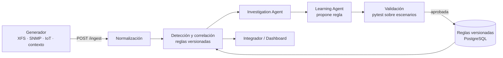

# 01 · Arquitectura y contratos

## Tres piezas

1. **Generador (ETL / simulación)**: produce datos. Expone `POST /ingest` para recibir mensajes o emite los suyos (HTTP o MQTT). Cada escenario es un script con estado y semilla fija para que la demo sea reproducible.
2. **Intérprete (núcleo del hackathon)**: normaliza, correlaciona, investiga y **aprende**. Aquí vive el ciclo RSI.
3. **Integrador / help desk**: presenta alertas y tickets en el dashboard. En el MVP solo presenta; en el pitch se menciona como siguiente lugar para aplicar aprendizaje (qué presentar y a quién).



## Campos de origen

- `source`: qué es el dispositivo → `atm`, `network`, `iot`, `vehicle`, `context`
- `protocol`: cómo llegó → `xfs`, `snmp`, `mqtt`, `http`

## Tipos de mensaje

| `type` | Qué representa | Lleva montos |
|---|---|---|
| `status` | Foto del estado (p. ej. cash out activo/inactivo) | No |
| `operation` | Algo que hizo el equipo: dispensado, retiro definitivo, recarga/visita | Sí, en `attributes` |
| `alert` | Advertencias y errores (p. ej. del dispensador) | No |
| `context` | Evento externo: sismo, lluvia, calor, asalto (por zona) | No |

### Evento normalizado

```json
{
  "event_id": "uuid",
  "device_id": "ATM-001",
  "ts": "2026-11-09T12:30:00-06:00",
  "source": "atm",
  "protocol": "xfs",
  "type": "operation",
  "code": "DISPENSE",
  "severity": "info",
  "attributes": {
    "cassette": 2,
    "denomination": 200,
    "requested": 1000,
    "dispensed": 1000,
    "count_before": 15,
    "count_after": 10
  }
}
```

"Cuánto quedó" no se manda: se valida con `count_before - dispensed/denomination == count_after`. Si no cuadra, es anomalía.

### Códigos de operación (iniciales, completar con el equipo)

- `DISPENSE` · dispensado
- `WITHDRAWAL_FINAL` · retiro definitivo
- `REPLENISH` · recarga / visita
- _(pendiente: otros códigos que ya maneja el equipo)_

## Ciclo de vida del cash out

- **Abre ticket** cuando llega `status` de cash out **o** el conteo de un cassette llega a 0.
- **Cierra ticket** con lo primero que ocurra:
  1. `operation` `REPLENISH` del dispositivo,
  2. `DISPENSE` exitoso de ese cassette (volvió a detectar billetes),
  3. `status` cash out = 0.
- El ticket guarda `closed_by` con cuál de los tres lo cerró.
- **v0** solo cierra con `status = 0`; **la lección aprendida** es cerrar con la recarga o el dispensado (ver doc 02).

## Perfil de dispositivo (fijo, en BD)

```json
{
  "device_id": "ATM-001",
  "source": "atm",
  "region": "costa",
  "site_type": "supermercado",
  "placement": "interior",
  "geo": {"lat": 19.30, "lon": -99.15}
}
```

Permite umbrales por región o tipo de sitio (playa, exterior, centro comercial) en lugar de umbrales rígidos.

## Incidente

```json
{
  "id": "INC-0001",
  "device_ids": ["ATM-001"],
  "opened_at": "...",
  "closed_at": "...",
  "closed_by": "REPLENISH",
  "severity": "high",
  "summary": "Cash out cassette 2",
  "rule_id": "R-CASHOUT-CLOSE",
  "rule_version": 1,
  "decided_by": "system"
}
```

## Regla (JSON declarativo, no código generado)

```json
{
  "id": "R-XFS-PREFAIL",
  "version": 2,
  "kind": "sequence",
  "applies_to": {"source": ["atm"], "region": "*"},
  "params": {
    "codes": ["DISP_WARN_LOW", "DISP_JAM_WARN", "DISP_JAM_WARN"],
    "window_minutes": 30
  },
  "action": {"open_incident": true, "severity": "medium"},
  "status": "validated",
  "parent_version": 1,
  "lesson_id": "L-003",
  "tests": {"passed": 12, "failed": 0}
}
```

Tipos: `sequence`, `threshold`, `flapping`, `trend`, `lifecycle` (apertura/cierre de tickets). Los umbrales pueden depender del perfil.

## Fuentes no registradas (idea de producto, tarjeta simple en el MVP)

Cuando llegan mensajes de una fuente/protocolo desconocido, el sistema sugiere: _"Están llegando mensajes SNMP de 12 dispositivos desconocidos. ¿Agregar, asignar reglas o ignorar?"_. Ignorar silencia el conjunto completo.

## Plan B de base de datos

`DATABASE_URL` apunta al PostgreSQL existente; si falla en Windows/macOS, cambiar a SQLite con una sola variable.
