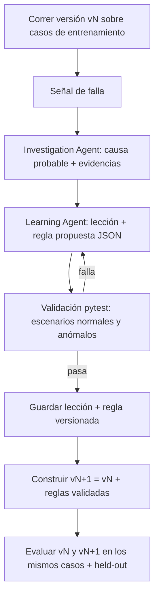

# 02 · Ciclo de aprendizaje y evaluación

Este documento responde directamente a la rúbrica: **qué señal detectó la falla, cómo se guardó la lección y cómo se incorporó al sucesor**, medido sobre los mismos casos.

## Versiones del sistema

| Versión | Qué tiene | Cómo nace |
|---|---|---|
| **v0 · baseline** | Reglas fijas escritas por el equipo | Intervención del **equipo** |
| **v1 · sucesor** | v0 + reglas aprendidas en la ronda 1 | Construida por el **sistema** |
| **v2 · sucesor** | v1 + lecciones de la ronda 2 (opcional) | Construida por el **sistema** |

Cada versión es un snapshot: `ruleset_version` + conjunto de reglas activas. Se guarda en `rulesets/v0.json`, `v1.json`, … y en BD.

## El ciclo (una ronda)



## Señales de falla (cómo el sistema sabe que se equivocó)

Cada caso del simulador trae su **verdad esperada** (`expected.json`: qué incidentes deberían abrirse, cuándo y cómo deberían cerrarse). La señal es la diferencia entre lo que hizo vN y lo esperado:

- **Incidente no detectado** (falso negativo): la falla ocurrió y no hubo alerta previa.
- **Alerta falsa** (falso positivo): alerta en escenario normal.
- **Ticket que no cierra a tiempo**: cash out que sigue abierto después de la recarga.
- **Tickets duplicados**: 10 tickets en vez de 1 incidente regional.
- **Cuentas que no cuadran**: `count_before`/`count_after` inconsistentes.

## La lección (cómo se guarda)

```json
{
  "lesson_id": "L-001",
  "round": 1,
  "signal": "ticket_not_closed",
  "evidence": ["INC-0004 abierto 47 min tras REPLENISH en ATM-003"],
  "hypothesis": "El cash out termina cuando el dispositivo vuelve a tener billetes, no cuando llega status=0",
  "proposed_rule": "R-CASHOUT-CLOSE v1",
  "validation": {"passed": 8, "failed": 0, "cases": ["cashout_*"]},
  "created_by": "system",
  "approved_by": "tests"
}
```

Las lecciones se acumulan en `lessons/` y en BD; v2 debe mostrar qué se **acumuló** sobre v1.

## Lecciones concretas para la demo

1. **XFS (principal)**: secuencia de advertencias del dispensador antes de la falla → regla `sequence` que alerta antes. Su forma persistida, todavía en borrador, está en `docs/spec/SPEC-0002-signal-sequence.md`: logs ordenados por tiempo, ticket de la falla y outcome fuera de esa lectura.
2. **Cash out**: cerrar con `REPLENISH` o `DISPENSE` exitoso → regla `lifecycle`; baja el tiempo de ticket abierto.
3. **SNMP**: interfaz que alterna activa/inactiva → regla `flapping` (reutiliza la lógica de secuencia/ventana).
4. **IoT**: temperatura que sube progresivamente → regla `trend` con umbral por región.

## Evaluación (lo que se reporta)

- **Mismos casos de evaluación** para v0, v1 y v2.
- **Casos reservados (held-out)**: escenarios que el sistema no vio al aprender (p. ej. otra semilla, otro dispositivo, otra región o la fuente SNMP).
- Métricas sacadas de **pruebas ejecutadas, no inventadas**:

| Métrica | Significado para el problema |
|---|---|
| Fallas detectadas antes de ocurrir | Prevención real |
| Falsos positivos por lote | Ruido para el help desk |
| Tickets duplicados por lote | Trabajo extra de operación |
| Minutos promedio de ticket abierto tras la recarga | Tiempo de revisión |
| % casos held-out resueltos | Que lo aprendido sí generaliza |

Comando sugerido: `pytest evals/ --ruleset v0 v1 v2 --report evals/report.json` → genera la tabla que muestra el dashboard.

**También mostrar qué sigue fallando** (la rúbrica lo pide): listar casos held-out donde v2 aún falla y por qué.

## Separar sistema vs equipo

Toda acción guarda `actor: "system" | "team"`. En el dashboard y en la bitácora se etiqueta:
- `SISTEMA`: detección, hipótesis, regla propuesta, validación, nueva versión.
- `EQUIPO`: reglas v0, escenarios del simulador, ajustes manuales, aprobación de umbrales si la hubo.
