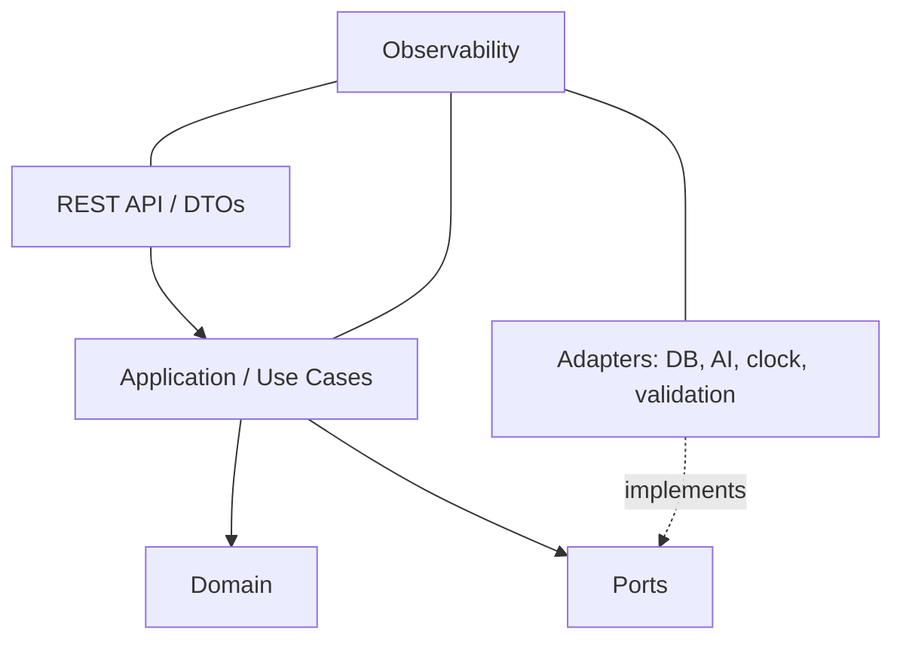

# ARC-0001: Arquitectura modular de la Central SignalLoop

## 1. Propósito

Definir los límites de responsabilidad de la aplicación Quarkus de la Central para que sea reemplazable, verificable y desplegable como una unidad independiente.

## 2. Antecedentes

RFC-0001 propone una aplicación modular única con un JAR ejecutable y contenedor Docker. Los contratos de eventos y aprendizaje existentes están en `context/01` y `context/02`.

## 3. Problema

Sin límites explícitos, endpoints, persistencia y lógica de negocio tienden a mezclarse; las integraciones de agente pueden contaminar el dominio y hacer difícil probar o cambiar proveedores.

## 4. Alcance

Define módulos lógicos, dependencias permitidas y flujo de procesamiento. No fija paquetes Java concretos ni entidades ORM finales.

## 5. No objetivos

- No define topología de microservicios.
- No define esquema SQL ni proveedor de IA.
- No garantiza disponibilidad o throughput sin objetivos cuantitativos.

## 6. Definiciones

- **Dominio:** conceptos y reglas de negocio independientes de frameworks.
- **Caso de uso:** operación de aplicación que coordina dominio y puertos.
- **Puerto:** interfaz requerida/ofrecida por una capa.
- **Adaptador:** implementación de un puerto para HTTP, base de datos, IA, reloj u otro sistema.

## 7. Propuesta / Diseño

### Módulos

| Módulo | Responsabilidad | No debe |
|---|---|---|
| `api` | HTTP, DTO, validación de entrada, mapeo de errores y OpenAPI | Contener decisiones de reglas o acceso SQL directo |
| `application` | Casos de uso, límites transaccionales, autorización de acciones del sistema/equipo | Depender de clases HTTP o SDK de IA concreto |
| `domain` | Evento, perfil, incidente, regla declarativa, lección, versión y políticas deterministas | Conocer Quarkus, JSON de transporte o proveedor externo |
| `ports` | Interfaces para repositorios, agente, reloj, validador, publicación/eventos | Exponer detalles de infraestructura al dominio |
| `adapters` | Implementaciones de persistencia, proveedor IA, validadores y mensajería | Saltarse casos de uso para mutar dominio |
| `observability` | Logs estructurados, métricas, trazas y auditoría | Registrar secretos o payloads sensibles completos por defecto |

### Flujo de ingreso

1. API valida estructura, autenticación/configuración aplicable y límites de solicitud.
2. Caso de uso asigna/valida identidad, idempotencia y correlación.
3. Adaptador de normalización convierte formatos de fuente al evento común preservando atributos específicos.
4. Dominio aplica validaciones estructurales y detección determinista.
5. Casos de uso registra evento e incidentes a través de puertos.
6. Solo señales justificadas pueden iniciar investigación probabilística.
7. Una propuesta de lección/regla pasa a validación; la activación es una operación explícita y auditable.

### Dependencias

Dependencias permitidas apuntan hacia dentro: API → application → domain. Adaptadores implementan puertos definidos hacia dentro. El dominio no depende de Quarkus, Hibernate, REST, cliente HTTP ni SDK LLM.

### Independencia y escalado

La primera entrega es un proceso desplegable independiente. Módulos internos no implican procesos separados. Operaciones lentas de agente deben poder tener timeout y estado observable; decidir ejecución en segundo plano/cola en SPEC tras acordar latencia y volumen. Toda coordinación debe aceptar correlation ID y guardar actor, versión de reglas y resultado.

## 8. Alternativas consideradas

- **Capas tradicionales con dominio acoplado a ORM:** menos interfaces al inicio, pero aumenta acoplamiento y dificulta pruebas/proveedor intercambiable.
- **Microservicio por agente:** despliegue independiente, pero costos de red/operación no justificados para el primer alcance.
- **Módulos Quarkus separados en artefactos:** posible más adelante; un único artefacto simplifica arranque reproducible mientras el equipo valida límites.

## 9. Riesgos

- Interfaces excesivas pueden enlentecer una entrega hackathon; mantener puertos solo en fronteras que cambian o requieren prueba aislada.
- Persistencia compartida mal definida puede hacer que el servicio no sea realmente independiente.
- Procesamiento asíncrono cambia semántica de API y debe especificarse antes de adoptarlo.

## 10. Preguntas abiertas

- ¿El módulo de normalización vive dentro de `application` o como dominio/adapter separado por protocolo?
- ¿Se persiste el evento crudo junto al normalizado?
- ¿Qué acciones requieren aprobación humana y cuáles pueden aprobarse automáticamente por política?
- ¿Cómo se expresa estado de análisis asíncrono al cliente?

## 11. Documentos relacionados

- `docs/rfc/RFC-0001-central-quarkus.md`
- `docs/spec/SPEC-0001-event-contract.md`
- `docs/agents/README.md`
- `context/01_arquitectura_y_contratos.md`
- `context/02_ciclo_de_aprendizaje_y_evaluacion.md`

## 12. Changelog

| Versión | Fecha | Cambio |
|---|---|---|
| 0.1.0 | 2026-11-09 | Límites modulares iniciales. |
