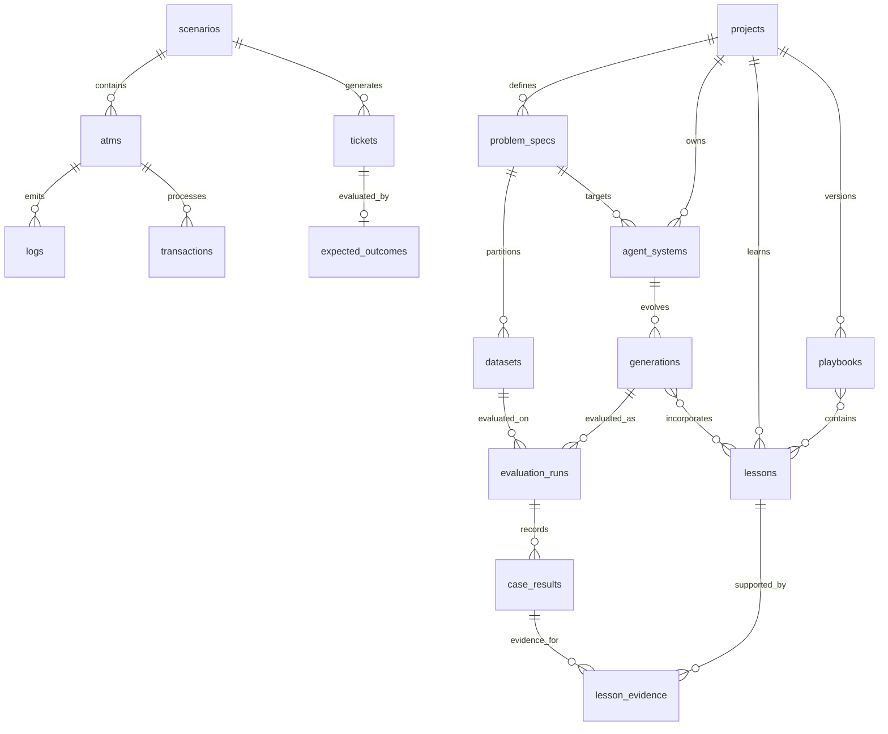

# Especificación de la migración inicial PostgreSQL V001

## 1. Propósito

Describir de forma verificable los objetos y límites que define `db/migrations/V001__initial_schemas.sql`, sin duplicar la guía de ejecución de `docs/database-setup.md`.

## 2. Antecedentes

La migración inicial prepara almacenamiento para la evolución/evaluación de sistemas agentes y para los escenarios sintéticos ATM que los evalúan. Este es el esquema SQL realmente presente; las propuestas de arquitectura de Central están en Draft.

## 3. Problema

La migración agrupa múltiples entidades de dos dominios y no tiene una especificación estable de inventario, relaciones, reglas de integridad o efectos de borrado.

## 4. Alcance

- Inventario de tablas por esquema.
- Catálogos y constraints de integridad observados.
- Claves foráneas y borrados en cascada explícitos.
- Índices secundarios creados por V001.
- Elementos que el SQL no garantiza.

## 5. No objetivos

- No propone una reescritura de tablas ni cambios SQL.
- No documenta código runtime inexistente ni define ORM/migrador.
- No reemplaza `docs/database-setup.md` como runbook local.

## 6. Definiciones

- **FK:** clave foránea que preserva referencia a una fila relacionada.
- **UNIQUE:** restricción que impide duplicar una clave o combinación indicada.
- **CHECK:** restricción que limita valores o rangos.
- **Cascada:** borrado automático solo donde el SQL declara `ON DELETE CASCADE`.
- **Índice secundario:** índice creado explícitamente por `CREATE INDEX`, distinto de índices internos de PK/UNIQUE.

## 7. Propuesta / Diseño

### 7.1 Inventario

#### `project` (15 tablas)

`projects`, `problem_specs`, `datasets`, `agent_systems`, `generations`, `evaluation_runs`, `case_results`, `lessons`, `lesson_evidence`, `generation_lessons`, `change_decisions`, `mutation_stats`, `playbooks`, `playbook_lessons`, `transfer_experiments`.

#### `simulator` (9 tablas)

`scenarios`, `atms`, `tickets`, `error_catalog`, `runbooks`, `logs`, `transactions`, `expected_outcomes`, `dataset_exports`.

Las responsabilidades de cada tabla están en `docs/database-setup.md`, con definición canónica en el SQL de V001.

### 7.2 Relaciones funcionales

This is a conceptual subset; inspect the SQL for every actual FK, including `change_decisions`, `mutation_stats`, transfer experiments and optional simulator references.

### 7.3 Important uniqueness constraints

- Project slug is unique.
- Problem key is unique within project.
- Dataset name is unique within problem specification.
- Generation number and config hash are each unique within agent system.
- Case key is unique within evaluation run.
- Lesson key is unique within project.
- Scenario key/version, ATM key per scenario, ticket key per scenario, error code per scenario, runbook key per scenario are unique.
- One outcome per ticket; dataset export version unique by scenario and split.
- Candidate generation ID has a unique change-decision row.

### 7.4 Check catalogs and numeric bounds

| Concept | Values / bound |
|---|---|
| Agent system role | `solver`, `builder` |
| Generation status | `proposed`, `evaluating`, `accepted`, `rejected`, `failed`, `baseline` |
| Generation change type | `prompt`, `tool`, `strategy`, `lessons`, `builder`, `other` |
| Dataset/ticket/export split | `train`, `validation`, `test` |
| Evaluation run status | `queued`, `running`, `completed`, `failed`, `cancelled` |
| Lesson scope | `case`, `domain`, `cross_domain`, `process` |
| Lesson status | `proposed`, `accepted`, `rejected`, `superseded` |
| Lesson source | `reflector`, `human`, `distillation` |
| Evidence role | `support`, `counterexample` |
| Change decision | `accepted`, `rejected`, `inconclusive`, `failed` |
| Transfer condition/status | `with_playbook`/`without_playbook`; `planned`, `running`, `completed`, `failed` |
| Scenario status | `draft`, `generated`, `frozen` |
| Ticket/outcome category | `hardware`, `network`, `software`, `reconciliation`, `fraud` |
| Ticket/outcome severity | `P1`, `P2`, `P3` |
| Log level | `DEBUG`, `INFO`, `WARN`, `ERROR`, `FATAL` |
| Log/error subsystem | `XFS`, `IO`, `NETWORK`, `CORE`, `FRAUD`, `RECONCILIATION` |
| Transaction type/status | `withdrawal`, `deposit`, `balance_inquiry`, `reversal`; `approved`, `declined`, `reversed`, `pending` |
| Scores/confidence | `0` to `1` inclusive where constrained |
| Counts/generation/version | Nonnegative where constrained; scenario version and playbook version positive |

### 7.5 Referential actions

Explicit `ON DELETE CASCADE` applies to:

- `project.case_results` when an evaluation run is deleted.
- `project.lesson_evidence` when its lesson or case result is deleted.
- `project.generation_lessons` when its generation is deleted.
- `project.playbook_lessons` when its playbook is deleted.
- Scenario-owned simulator rows (ATMs, tickets, error catalog, runbooks, logs, transactions, expected outcomes and dataset exports) when their scenario is deleted, with the direct cascade rules shown in V001.
- ATM logs and transactions when their ATM is deleted.
- Ticket expected outcome when its ticket is deleted.

`simulator.logs.ticket_id` and `simulator.transactions.ticket_id` use `ON DELETE SET NULL`. Other FKs use PostgreSQL default `NO ACTION`/restrict semantics; do not infer cascading behavior.

### 7.6 Explicit secondary indexes (12)

| Index | Columns | Intended lookup inferred from name/columns |
|---|---|---|
| `idx_generations_system_created` | `generations(system_id, created_at DESC)` | Historial reciente por sistema |
| `idx_evaluation_generation_dataset` | `evaluation_runs(generation_id, dataset_id)` | Corridas por generación/dataset |
| `idx_case_results_run` | `case_results(evaluation_run_id)` | Resultados de corrida |
| `idx_lessons_project_status` | `lessons(project_id, status)` | Lecciones por proyecto/estado |
| `idx_lesson_evidence_result` | `lesson_evidence(case_result_id)` | Lecciones apoyadas por un resultado |
| `idx_transfer_target` | `transfer_experiments(target_problem_spec_id, condition)` | Experimentos por problema/condición |
| `idx_sim_tickets_scenario_split` | `tickets(scenario_id, split)` | Tickets de partición por escenario |
| `idx_sim_tickets_severity` | `tickets(scenario_id, severity)` | Tickets por severidad en escenario |
| `idx_sim_logs_atm_time` | `logs(atm_id, occurred_at)` | Logs por ATM y tiempo |
| `idx_sim_logs_ticket` | `logs(ticket_id)` | Logs por ticket |
| `idx_sim_txn_atm_time` | `transactions(atm_id, occurred_at)` | Transacciones por ATM y tiempo |
| `idx_sim_txn_ticket` | `transactions(ticket_id)` | Transacciones por ticket |

Los propósitos de búsqueda son inferencias por columnas/nombres; medir planes reales antes de afirmar beneficios de rendimiento.

### 7.7 Invariantes que requieren capa superior

V001 no basta para imponer:

- Inmutabilidad de filas de dataset o generación aceptada.
- Que un escenario o exportación `frozen` no se modifique.
- Aislamiento del split `test` frente al agente que aprende.
- Consistencia entre `item_count`/`row_count` y filas asociadas.
- Correspondencia entre el hash guardado y contenido real.
- Que promedios/deltas/intervalos de una decisión correspondan al grupo de corrida indicado.
- Que la versión de regla/playbook aceptada sea efectivamente la activa en producción.

Estos requisitos necesitan permisos, transacciones, código de aplicación, triggers, o especificaciones adicionales explícitas.

### 7.8 Dependencia UUID

Cada UUID generado por defecto usa `gen_random_uuid()`. V001 no ejecuta `CREATE EXTENSION` ni fija versión mínima del servidor. El setup debe verificar la función y la migración futura debe aclarar la política de compatibilidad sin modificar silenciosamente una V001 ya aplicada.

## 8. Alternativas consideradas

- Mantener solo el SQL como documentación: fiel a la implementación, pero difícil para revisar conceptos, catálogo y política de datos.
- Copiar todos los `CREATE TABLE` a esta SPEC: duplicaría la fuente y produciría drift; este documento resume e identifica la migración fuente.
- Suponer que nombres como `immutable` o `frozen` se aplican automáticamente: no corresponde a las restricciones que contiene el SQL.

## 9. Riesgos

- Actualizar esta SPEC sin revisar la migración puede introducir divergencia; la migración es fuente de verdad de la estructura implementada.
- Los catálogos `CHECK` requieren migraciones posteriores para admitir nuevos valores.
- Cambiar acciones de borrado afecta datos evaluativos y evidencia histórica.
- Datos `expected`/outcomes pueden filtrar labels si controles de acceso/capas de aplicación son débiles.
- La portabilidad a SQLite no es viable sin otra migración y evaluación de diferencias de tipos/JSON/FK.

## 10. Preguntas abiertas

1. ¿Esta especificación se mantendrá como inventario del SQL o evolucionará a contrato de datos aprobado?
2. ¿Qué política convierte estado `accepted`/`frozen` en inmutabilidad efectiva?
3. ¿Necesita el almacén protección a nivel de DB para test outcomes?
4. ¿Qué valores de `change_type`, categorías y subsistemas se prevén para nuevas fuentes SNMP/MQTT/vehículo?
5. ¿Cuáles FKs necesitan `ON DELETE RESTRICT`, `CASCADE` o `SET NULL` explícitos como decisión de producto?

## 11. Documentos relacionados

- `db/migrations/V001__initial_schemas.sql`
- `docs/database-setup.md`
- `docs/rfc/RFC-0001-central-quarkus.md`
- `docs/architecture/ARC-0001-central-modular.md`
- `context/02_ciclo_de_aprendizaje_y_evaluacion.md`

## 12. Changelog

| Versión | Fecha | Cambio |
|---|---|---|
| 0.1.0 | 2026-11-09 | Inventario inicial de V001, constraints, FKs, índices y límites no garantizados. |
