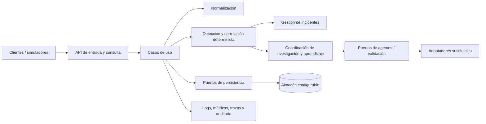

# RFC-0001: Central SignalLoop independiente en Java Quarkus

## 1. Propósito

Proponer la arquitectura y el proceso de especificación para construir la Central/Intérprete de SignalLoop como servicio Java con Quarkus, empaquetado como JAR y ejecutable en contenedor Docker de forma reproducible.

Este RFC es una propuesta en revisión. No autoriza por sí solo la implementación ni resuelve decisiones pendientes.

## 2. Antecedentes

SignalLoop recibe eventos de ATM/XFS, redes/SNMP, IoT/MQTT y otras fuentes; normaliza, correlaciona, investiga incidentes y conserva reglas validadas para reutilizarlas. Los contratos y el ciclo descritos en `context/01_arquitectura_y_contratos.md` y `context/02_ciclo_de_aprendizaje_y_evaluacion.md` son la base funcional disponible.

La propuesta anterior habla de FastAPI. La dirección actual indicada por el responsable del proyecto es que la Central se construya con Java Quarkus. Esta decisión tecnológica debe quedar revisada y aceptada en este RFC antes de convertirse en especificación.

## 3. Problema

El equipo necesita un núcleo backend que pueda ejecutarse sin depender del dashboard, los simuladores ni un proveedor de agentes específico; que acepte los contratos de evento acordados, y que pueda reproducirse localmente y desplegarse como servicio contenedorizado.

## 4. Alcance

- Definir la Central como aplicación Quarkus empaquetada en JAR.
- Definir límites modulares entre API, dominio, adaptadores, persistencia y coordinación de análisis/agentes.
- Proponer ejecución en Docker, configuración por entorno, health checks y observabilidad mínima.
- Definir agentes documentales `.md` con responsabilidades, autoridad, contexto requerido y contrato de salida.
- Establecer el orden de trabajo: RFC, revisión, ADR, especificaciones, implementación y validación.

## 5. No objetivos

- No generar ahora el código del servicio ni Dockerfile.
- No fijar proveedor/modelo LLM, SDK de agentes, PostgreSQL/SQLite, broker ni estrategia cloud.
- No ejecutar código arbitrario generado por un agente.
- No reemplazar los contratos de eventos existentes sin revisión.
- No separar prematuramente la aplicación en microservicios.

## 6. Definiciones

- **Central/Intérprete:** servicio de dominio que recibe eventos y coordina normalización, detección, incidentes y ciclo de aprendizaje.
- **Agente:** trabajador lógico con una misión acotada; puede ser una instrucción `.md`, un componente determinista o un adaptador a un modelo. La palabra no presupone ejecución autónoma con LLM.
- **Regla:** documento/objeto declarativo versionado que solo se activa tras validación definida.
- **Puerto/adaptador:** interfaz del dominio y su implementación tecnológica sustituible.
- **Independiente:** el servicio puede arrancar, exponer su API y operar su núcleo sin UI ni simulador; integraciones externas se configuran explícitamente.

## 7. Propuesta / Diseño

### 7.1 Forma de despliegue

Aplicación modular única (`central-api`) en Java/Quarkus. El artefacto de ejecución es un JAR ejecutable; Docker construye o recibe el artefacto, inicia el proceso Java como proceso principal y publica el puerto configurado. La imagen debe poder reconstruirse desde el repositorio con versiones y pasos documentados. Compose puede ofrecer un perfil local con dependencias opcionales, pero no es requisito hasta decidir la base de datos.

Configuración por variables de entorno; secretos fuera de la imagen. El contenedor debe exponer endpoints de liveness/readiness apropiados y terminar con señales correctamente propagadas. La política de usuario no-root y la imagen base se decidirán en la especificación de despliegue.

### 7.2 Módulos lógicos

Los módulos son límites de código dentro del mismo despliegue inicial. No se recomienda distribuirlos en procesos hasta existir métricas que justifiquen esa complejidad.

Responsabilidades propuestas:

1. `api`: recursos REST, validación de transporte, versionado y errores HTTP; no contiene reglas de negocio.
2. `application`: casos de uso y transacciones, sin acoplamiento a HTTP ni SDK de proveedor.
3. `domain`: eventos normalizados, incidentes, reglas, lecciones, versiones y políticas deterministas.
4. `adapters`: persistencia, reloj, proveedores de agentes, ejecución de validaciones y transporte opcional.
5. `observability`: correlación de solicitudes, actor (`system`/`team`), auditoría y métricas sin datos sensibles innecesarios.

### 7.3 Contrato y procesamiento

La API debe aceptar un sobre común de evento y preservar el payload específico de la fuente. La forma final del esquema, idempotencia, límites de tamaño, semántica de estado, códigos y compatibilidad se definirán en `SPEC-0001-event-contract.md`; este RFC no redefine el esquema de `context/01`.

El procesamiento determinista debe ejecutarse antes de solicitar razonamiento probabilístico. Las salidas de agentes son propuestas tipadas con evidencia y referencias a eventos/incidentes; nunca activan reglas directamente. El flujo de propuesta → validación → aprobación/activación debe ser explícito, versionado y auditable.

### 7.4 Escalabilidad y replicabilidad

- Mantener el núcleo sin estado de sesión en memoria como fuente de verdad; estado de negocio en un almacén aún por decidir.
- Diseñar operaciones idempotentes para reintentos y asignar identificadores de correlación.
- Aislar integraciones lentas mediante puertos y límites de tiempo; decidir sincronía/cola a partir de volumen y latencia objetivo.
- No prometer escalado horizontal completo hasta decidir persistencia, concurrencia, retención e índices.
- Proveer configuración de ejemplo sin secretos, pasos de construcción y arranque, y escenarios de aceptación repetibles.

### 7.5 Plan de documentación e implementación

1. Revisar/aceptar este RFC y registrar la decisión tecnológica en ADR.
2. Acordar SPEC de evento, API, regla, incidente, persistencia y despliegue.
3. Crear esqueleto Quarkus ejecutable y comprobar arranque local/JAR.
4. Implementar API y procesamiento determinista con adaptadores falsos.
5. Agregar almacenamiento elegido y migraciones.
6. Agregar coordinación de agentes detrás de interfaces, manteniendo opción determinista sin LLM.
7. Construir imagen Docker y documentar arranque/health checks.
8. Validar en Windows y macOS según el alcance de portabilidad acordado.

### 7.6 Criterios de aceptación del RFC (para derivar a specs)

- La misma versión del repositorio produce el mismo contrato de API y una imagen construible con pasos documentados.
- La aplicación arranca como JAR fuera del contenedor y como proceso principal en Docker.
- La ausencia de UI/simulador no impide arrancar y usar la API.
- Fallos de proveedor de agente no alteran la integridad del evento ni activan reglas no validadas.
- Una petición repetida con la misma clave de idempotencia no duplica el efecto de negocio definido.
- Logs permiten seguir una petición/evento por identificador de correlación sin registrar secretos.

## 8. Alternativas consideradas

- **FastAPI:** encaja con documentos previos y ciclo de demo; descartado como dirección actual por la petición explícita de una Central Java Quarkus. Reconsiderable si el equipo prioriza velocidad o reutilizar código Python.
- **Microservicios desde el inicio:** no recomendado; eleva carga operativa sin datos de escalado. Un monolito modular conserva límites y permite extracción posterior.
- **Agentes acoplados a un proveedor:** no recomendado; contradice independencia y portabilidad. Usar interfaces/adaptadores.
- **Ejecutar reglas generadas como código:** rechazado por el contrato funcional existente; reglas declarativas deben pasar validación antes de activarse.

## 9. Riesgos

- Migrar el rol antes descrito como FastAPI a Quarkus puede duplicar trabajo con otros equipos o artefactos.
- El término “agente” puede confundirse entre instrucciones de trabajo `.md` y agentes LLM ejecutables; mantener esa distinción explícita.
- Sin límites de carga, latencia, retención y disponibilidad no se puede garantizar escalabilidad cuantitativa.
- Sin decisión de persistencia no puede cerrarse idempotencia, transacciones ni despliegue Compose.
- Java/Quarkus en contenedor requiere acordar runtime/JVM o compilación nativa; el JAR solicitado apunta inicialmente a JVM.

## 10. Preguntas abiertas

1. ¿El equipo acepta Quarkus como reemplazo de FastAPI para la Central, o Quarkus solo para la capa API?
2. ¿Qué significa “independiente” en la primera entrega: solo API separada o también almacenamiento y agente ejecutables localmente?
3. ¿PostgreSQL existente es obligatorio para MVP? ¿Se necesita modo local sin base de datos?
4. ¿La Central recibe solo HTTP al inicio o también MQTT?
5. ¿Los agentes `.md` son contratos para Codex/otros trabajadores durante desarrollo, o también se pretende cargarlos como configuración operativa en runtime?
6. ¿Qué proveedor de IA queda permitido y qué requisitos de privacidad/red aplican?
7. ¿Qué volumen, latencia, retención y disponibilidad son objetivos del primer despliegue?
8. ¿Dónde se desplegará y se requiere Compose para desarrollo, producción o ambos?

## 11. Documentos relacionados

- `.augura/ROOT_MEMORY.md`
- `.augura/AGENT_TEMPLATE.md`
- `.augura/AKB-0000-The-Augura-Engineering-Manifesto.md`
- `.augura/AKB-0001-Knowledge-Standard.md`
- `context/01_arquitectura_y_contratos.md`
- `context/02_ciclo_de_aprendizaje_y_evaluacion.md`
- `context/03_plan_8h_y_roles.md`
- `docs/architecture/ARC-0001-central-modular.md`
- `docs/spec/SPEC-0001-event-contract.md`
- `docs/agents/README.md`

## 12. Changelog

| Versión | Fecha | Cambio |
|---|---|---|
| 0.1.0 | 2026-11-09 | Borrador inicial para Central Quarkus y ejecución reproducible en Docker. |
