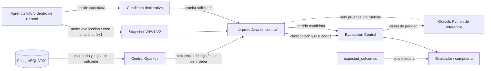

# SPEC-0003: Intérprete versionado en Central con paridad de referencia

## 1. Propósito

Definir el primer corte del intérprete de clasificación que se construirá dentro del codebase Java de `central/`, usando `SignalLoopMixto/` solo como referencia funcional y oráculo temporal de paridad. También propone una estructura inequívoca para V0, V1 y V2 dentro del codebase destino.

Este documento está en Draft. El motor Python actual sirve de referencia ejecutable para el DSL de lecciones; no se considera todavía el intérprete real requerido por la demo.

## 2. Antecedentes

`central/` usa Quarkus 3.38.3, Java 21, PostgreSQL y Flyway. Ya persiste escenarios, ATM, tickets, logs y outcomes. `GET /api/v1/atms/{id}/logs` devuelve la secuencia temporal sin outcomes.

`SignalLoopMixto/` contiene lógica útil como referencia: el motor en `aprendiz/motor.py`, el ciclo de aprendizaje y los contratos de casos, corridas y lecciones. Ese directorio **no es destino de desarrollo ni componente runtime**. La lógica aceptada se portará y evolucionará en Java dentro de `central/`; el código Python servirá temporalmente como oráculo independiente durante las pruebas de paridad. La evidencia de producto/demo debe salir de Central.

V001 tiene entidades para sistemas, generaciones, datasets, evaluación, resultados, lecciones y decisiones, pero Central aún no ofrece API para gestionarlas. La secuencia XFS descrita por SPEC-0002 es señal persistida; no es aún clasificación ni aprendizaje.

## 3. Problema

Sin un contrato de ejecución versionada, el intérprete podría leer reglas mutables, producir resultados que no indiquen qué lógica usaron o comparar versiones/candidatas distintas. También falta portar la semántica de referencia al dominio Central sin filtrar `expected_outcomes` hacia la lógica evaluada.

## 4. Alcance

- Separar detección determinista base, reglas aprendidas y evaluación de resultados.
- Establecer snapshots inmutables y directorios identificables para V0, V1 y V2.
- Adaptar el flujo de evaluación/candidata de referencia al codebase Central, sin conservar Python como dependencia runtime.
- Precisar el orden de corrida normal, candidata, promoción, ablación y held-out.
- Definir casos iniciales de prueba basados en C1–C6 y R1–R2.
- Especificar responsabilidades de Central, intérprete y futuro flujo de aprendizaje implementado dentro del destino Central.

## 5. No objetivos

- No habilita a un LLM para modificar o desplegar código Java/Python.
- No da por implementados endpoints de corridas, reglas, generaciones o evaluaciones en Central.
- No reemplaza el esquema SQL V001 ni convierte outcomes en entrada del clasificador.
- No exige que todo el ciclo permanezca en archivos a largo plazo; el contrato puede migrar a API/BD después de aceptar una nueva SPEC.
- No decide proveedor/modelo de IA ni plataforma cloud.

## 6. Definiciones

- **Intérprete:** ejecutor determinista que recibe un caso/eventos y un snapshot de versión y devuelve clasificación/tickets/resultados trazables.
- **Reglas base:** comportamiento escrito por el equipo y versionado en V0.
- **Lección:** regla declarativa candidata, activa o rechazada con evidencia; contrato actual en `SignalLoopMixto/contrato/leccion.schema.json`.
- **Snapshot:** configuración completa, inmutable y reproducible de la lógica aplicada por una versión.
- **Corrida normal:** lote completo de casos de banco/reservados ejecutado con el snapshot activo, sin candidata ni ablación.
- **Prueba de candidata:** lote de banco ejecutado con un snapshot base y una lección candidata adicional; no cambia por sí mismo la versión actual.
- **Reservado/held-out:** caso no usado para proponer o aceptar lecciones; se reporta por separado.
- **Outcome esperado:** verdad de referencia consumida solo por el evaluador y la compuerta, nunca por la función que clasifica.

## 7. Propuesta / Diseño

### 7.1 Componentes y responsabilidades



El diagrama distingue el estado implementado del objetivo: hoy Central persiste señal y outcome por rutas separadas; aún no hay intérprete ni ciclo de aprendizaje. `SignalLoopMixto` se usa solo para pruebas de paridad, no se despliega ni se importa como dependencia de Central.

**Central (Java/Quarkus):** producto y único destino de implementación; persiste escenarios, ATM, tickets y logs; entrega al intérprete una entrada sin outcome y, en fases posteriores, aloja corridas, generaciones, lecciones y evaluación.

**Intérprete (destino: Java en `central/`):** consume caso/secuencia y snapshot explícitos; porta la semántica validada de las reglas de referencia; devuelve clasificación y resultado por caso con versión, candidata/ablación y trazabilidad. Nunca lee `expected_outcomes` durante clasificación.

**Flujo de aprendizaje/runtime (implementación destino en `central/`):** el futuro componente leerá resultados, propondrá lecciones y ejecutará candidatas contra el intérprete Java. Solo podrá crear una generación sucesora tras cumplir esquema, evidencia, mejora y no regresión. `SignalLoopMixto/aprendiz/` es referencia de comportamiento, no se ejecuta como dependencia del producto.

**Evaluador:** compara resultado con etiqueta, calcula señales/métricas y aplica la compuerta fuera de la función de clasificación. El destino productivo es Central/Java. El evaluador Python puede usarse temporalmente como referencia de pruebas, no como runtime ni parte del despliegue.

### 7.2 Estructura versionada propuesta

El código y los fixtures de versiones viven en Central. El baseline V0 se incluye como recurso versionado; V1/V2 de producción se materializan como generaciones inmutables en `project.generations.config`/`config_hash`. Si una versión promovida se congela para revisión o demo, se exporta también a su carpeta de snapshot bajo `central/interpreter-versions/`. PostgreSQL conserva la versión activa y su historial como fuente de verdad del runtime. Esto permite probar versiones en carpetas y, a la vez, que el aprendizaje runtime no requiera editar/reconstruir el JAR para crear una generación.

```text
central/
├── src/main/resources/interpreter/versions/
│   ├── v0/
│   │   ├── version.json
│   │   └── reglas.json
├── src/main/java/io/signalloop/central/interpreter/
│   ├── domain/
│   ├── application/
│   └── adapters/
└── src/test/resources/interpreter/cases/
    ├── C1.json ... C6.json
    └── R1.json, R2.json

central/interpreter-versions/       # exportaciones revisables de snapshots promovidos
├── v0/{version.json,reglas.json}
├── v1/{version.json,reglas.json}
└── v2/{version.json,reglas.json}
```

Reglas de versionado:

1. `central/src/main/resources/interpreter/versions/v0/` contiene las reglas base acordadas por el equipo y metadata con padre `null`, actor `team`, esquema/semántica y hash.
2. `central/interpreter-versions/v1/` es una exportación de un snapshot completo promovido: V0 más las lecciones/reglas aceptadas. Su registro ejecutable de producción reside en `project.generations.config`; el directorio guarda `parent: "v0"`, lista de lecciones, hash y actor para reproducibilidad/revisión.
3. `central/interpreter-versions/v2/` se crea del mismo modo desde V1. Si no existe una segunda lección aprobada, V2 no se crea artificialmente. Cada versión promovida también queda en `project.generations`.
4. Los snapshots existentes son inmutables. Una corrección produce otra versión/snapshot y un registro de actor/motivo; no se sobreescribe V0/V1.
5. PostgreSQL en Central conserva la definición ejecutable por generación y el estado activo/historial. Las carpetas son baseline/exportaciones versionadas para inspección y reproducción, no un almacén mutable que el proceso edita dentro de la imagen.
6. Las candidatas no pertenecen a ningún snapshot hasta que pasan la compuerta. Una prueba registra base `version: vN` y `candidata: Lx` por separado.
7. Rechazo/retirada produce evidencia y una nueva versión derivada, si cambia la lógica activa; no borra historia ni edita snapshots anteriores.
8. Cada corrida guarda `config_hash`/hash del snapshot además de `version`, para identificar la lógica exacta usada y detectar cambios en una exportación.

**Estado respecto al código actual:** la lógica del intérprete, baseline de versión y carpetas exportadas todavía no existen en Central. `SignalLoopMixto/lecciones/activas/` y `versiones.json` son artefactos de referencia, no ubicación ni fuente de verdad del producto.

### 7.3 Contrato de corrida

El esquema de `SignalLoopMixto/contrato/corrida.schema.json` es referencia inicial para el contrato Java/API. Central persistirá los resultados; JSONL puede conservarse como exportación reproducible de pruebas. Cada resultado debe:

- incluir `run_id`, `lote`, `version`, `caso`, `conjunto`, `lecciones_activas`, `candidata`, `sin`, `esperado`, `obtenido`, `pasa` y `ts` según el esquema vigente;
- agregar o derivar `snapshot_hash` en una revisión versionada del esquema;
- preservar actor `interprete` y referencias de evidencia por ticket/evento;
- usar una única versión, lista de activas, candidata y modo en todo el lote;
- quedar asociado a un lote/evaluación; si falta un caso, la evaluación queda incompleta y no puede promover;
- mantener el registro de outcome separado de la entrada usada por el intérprete.

El contrato actual define `pasa` por igualdad de conteos de tickets; antes de adoptarlo para la clasificación nueva, el equipo debe confirmar si también se comparan categoría, severidad, causa y acción recomendada. No ampliar silenciosamente `pasa`.

### 7.4 Transición desde la señal XFS de Central

El adaptador destino en Central puede convertir la secuencia de `simulator.logs` ordenada por `(occurred_at, id)` a la entrada del intérprete sin duplicar producción de datos. La secuencia `DISP_WARN_LOW`, `DISP_JAM_WARN`, `DISP_JAM` es un patrón prefalla; por sí sola no especifica la clasificación de los casos C1–C6. Debe asociar el ticket como referencia, nunca convertir `expected_outcome` en evento.

Antes de implementar, definir cómo un caso de prueba representa el agregado V001. El primer corte acepta fixtures JSON bajo `central/src/test/resources/`; los casos existentes de SignalLoopMixto pueden servir temporalmente como fixtures de paridad.

### 7.5 Definición funcional V0/V1/V2

| Versión | Contenido | Creación | Invariante de comparación |
|---|---|---|---|
| V0 | Reglas base portadas a Java, sin lecciones aprendidas | Equipo | Snapshot fijo de referencia en Central |
| V1 | V0 + primera candidata aceptada, por ejemplo cierre CashOut con `REPLENISH` | Compuerta futura del flujo Central | Mismo banco; reservados solo se reportan |
| V2 | V1 + siguiente candidata aceptada según evidencia | Nueva compuerta del flujo Central | Mismos conjuntos; held-out separado |

Los ejemplos ilustran las lecciones listadas en el README/CONTRATO actual, no fijan cuál será V1/V2 final. La numeración se asigna al snapshot sucesor aceptado; no depende de la cantidad de candidatas fallidas.

### 7.6 Matriz mínima de pruebas

| Prueba | Base | Caso/entrada | Resultado esperado |
|---|---|---|---|
| V0 de referencia | `v0` | C1–C6 | Conteos coinciden con motor Python; la ficha actual indica 2/6 para las reglas base |
| Lección de ciclo de vida | `v0` + candidata L1 | C1 (cashout + REPLENISH) | Corrida de candidata corrige el caso de entrenamiento sin romper otro caso del banco antes de promover V1 |
| Equivalencia del motor | cada snapshot | C1–C6 y luego R1–R2 | Sin discrepancias de tickets entre Java y Python; reservados no participan en compuerta |
| Deduplicación | versión con lección dedup | C2 y un control sin duplicado | El duplicado no añade ticket; el control conserva su resultado |
| Silencio | versión con lección silencio | C4 y control con heartbeat | Se abre tras límite de 90 s y no se abre si hay latido |
| Flapping | versión con lección flapping | C5 y control estable | Repetición no duplica abierto; recuperación cierra y alarma dentro de ventana reabre el ticket correcto |
| Regresión | V0 frente a Vn | Todo el banco de entrenamiento | Ningún caso previamente correcto pasa a incorrecto para aceptar candidata |
| Transferencia held-out | snapshot candidato/final | R1/R2 | Reporte por separado; no se usan para proponer, aceptar o ajustar la candidata |
| Integridad de snapshots | V0/V1/V2 | Releer manifest y hash | Hash estable; corrida identifica exactamente la configuración usada |
| Fuga de etiquetas | clasificador | caso persistido con expected outcome | La entrada del intérprete no contiene ni serializa `expected_outcome` |

Las cifras de referencia provienen de SignalLoopMixto y se reproducen con su motor como benchmark inicial. La integración debe ejecutar el intérprete Java real de Central y comprobar paridad contra el oráculo Python; la demo reporta resultados de Central, no del simulador de referencia.

### 7.7 Fases de integración

1. **Congelar contrato:** aceptar modelos de caso, resultado, lección y snapshot; marcar train/validation/test.
2. **Aislar semántica destino:** definir interfaces Java bajo `central/src/main/java/io/signalloop/central/interpreter/` y portar reglas desde la referencia con los mismos límites/orden.
3. **Prueba de paridad:** ejecutar fixtures del banco en Central y en el oráculo Python; comparar resultado por caso y versión/hash.
4. **Snapshots destino:** crear V0 dentro de recursos/configuración Central; crear V1/V2 solo tras promoción aceptada y mantener snapshots previos inmutables.
5. **Evaluación en Central:** implementar casos de uso para lotes/candidatas; Python queda fuera del runtime y se usa solo como oráculo durante el port.
6. **Persistencia Quarkus:** especificar repositorios/tablas para generaciones/evaluaciones/lecciones; evitar DB y archivos como fuentes de verdad paralelas.
7. **Cloud/despliegue:** Central es la unidad de producto; cualquier worker separado se decide por métricas y se desarrolla como parte del codebase destino.

## 8. Alternativas consideradas

- **Usar SignalLoopMixto como runtime/componente:** no es el destino; el producto evoluciona sobre `central/`.
- **Eliminar de inmediato la referencia Python:** mantenerla temporalmente da un oráculo independiente para detectar errores del port Java.
- **Guardar solo una lista mutable de lecciones activas:** no conserva qué lógica ejecutó cada versión.
- **Snapshots versionados dentro de Central:** propuesta para reproducibilidad del intérprete destino.
- **Permitir que el LLM edite código del clasificador en ejecución:** descartado; los agentes runtime proponen datos/reglas declarativas, pruebas deciden elegibilidad y la promoción debe seguir la gobernanza explícita.

## 9. Riesgos

- Divergencia entre Python de referencia y Java destino: mitigar con paridad por banco; Python nunca se importa en runtime.
- Un índice activo y snapshots pueden contradecirse; elegir PostgreSQL en Central como fuente de verdad y publicar snapshots atómicamente.
- Exportaciones JSONL de pruebas pueden quedar incompletas; una evaluación parcial debe ser marcada incompleta y nunca promover.
- Los casos R1/R2 son pocos y no prueban generalización amplia; etiquetar la evidencia como demostración limitada.
- C1–C6 describen ciclo de tickets y las tablas V001/SPEC-0002 describen secuencia XFS; todavía no hay mapeo uno-a-uno demostrado entre formatos.
- Una lectura de `expected_outcomes` por el componente que clasifica produciría leakage y resultados inválidos.
- Versiones en carpetas crean más artefactos; deben ser snapshots inmutables con hashes, no copias editables sin procedencia.

## 10. Preguntas abiertas

1. ¿El flujo de aprendizaje en Central se ejecutará sincrónicamente o como worker/cola Java del mismo producto?
2. ¿Qué entrada procesa Central: logs V001, el caso JSON de referencia o un DTO nuevo?
3. ¿Qué campos determinan `pasa`: conteos, categoría, severidad, causa y/o acción?
4. ¿Se aceptan los snapshots dentro de recursos/configuración Central y PostgreSQL como fuente de verdad del estado activo?
5. ¿V0 conserva exactamente Alarma→ticket y Status=0→cierre?
6. ¿La compuerta requiere aprobación humana además de pruebas?
7. ¿Qué parte del JSONL se mantiene como exportación de prueba y qué estado pasa a PostgreSQL?

## 11. Documentos relacionados

- `central/README.md`
- `central/CONTEXT.md`
- `SignalLoopMixto/README.md` — referencia funcional, no destino.
- `SignalLoopMixto/CONTRATO.md` — contrato de referencia a adaptar.
- `SignalLoopMixto/aprendiz/motor.py` — oráculo temporal de paridad.
- `SignalLoopMixto/aprendiz/ciclo.py` — referencia del ciclo; no runtime destino.
- `SignalLoopMixto/contrato/caso.schema.json`
- `SignalLoopMixto/contrato/corrida.schema.json`
- `SignalLoopMixto/contrato/leccion.schema.json`
- `SignalLoopMixto/lecciones/versiones.json`
- `docs/spec/SPEC-0002-signal-sequence.md`
- `db/migrations/V001__initial_schemas.sql`
- `central/CONTEXT.md`
- `context/02_ciclo_de_aprendizaje_y_evaluacion.md`
- `docs/agents/AG-02-incident-investigator.md`
- `docs/agents/AG-03-rule-engineer.md`
- `docs/agents/AG-04-validation-auditor.md`

## 12. Changelog

| Versión | Fecha | Cambio |
|---|---|---|
| 0.2.0 | 2026-11-09 | Aclara Central como único destino, distingue baseline/exportaciones en carpetas de generaciones runtime persistidas en PostgreSQL y restringe Mixto al rol de oráculo. |
